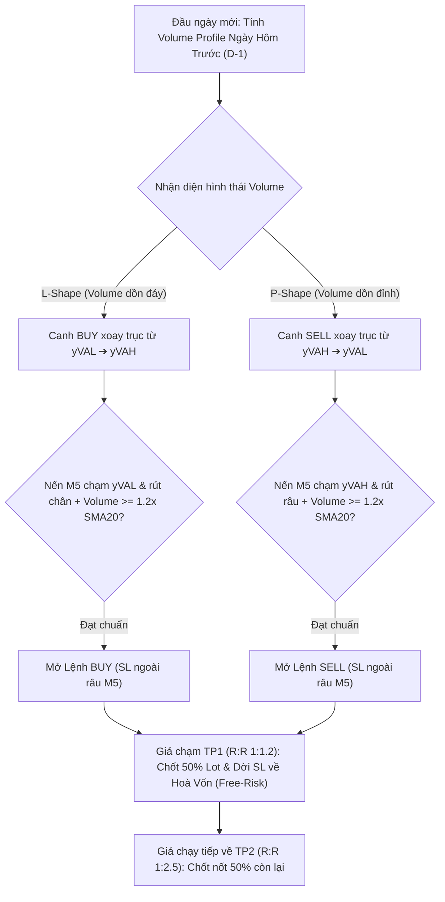

# 📖 HƯỚNG DẪN SỬ DỤNG EA BOT & BACKTEST MT5 (FX DREAM SYSTEM)

> **Tài sản áp dụng:** Vàng (`XAUUSD`, `XAUUSDc`) & Bitcoin (`BTCUSD`, `BTCUSDc`, `BTCUSDT`)  
> **Khung thời gian giao dịch:** Khung **M5** (5 Phút)  
> **Nguyên lý cốt lõi:** Scalping xoay trục theo **Volume Profile Ngày Hôm Trước (yVAL, yPOC, yVAH)** + Nến M5 rút chân/rút râu kích nổ Volume $\ge 1.2\times$ SMA(20) bảo vệ cản.

---

## 1. Cơ Chế Hoạt Động Của Chiến Lược



---

## 2. Các File Đã Được Tạo Sẵn Trong Hệ Thống

| Tên File | Vị Trí Lưu Trữ | Chức Năng |
| :--- | :--- | :--- |
| **`FXDream_VolumeProfile_Scalper.ex5`** | `...\MQL5\Experts\` & thư mục dự án | File thực thi của EA **đã được biên dịch sẵn**, chỉ việc mở MT5 là thấy ngay |
| **`FXDream_VolumeProfile_Scalper.mq5`** | `...\MQL5\Experts\` & thư mục dự án | Mã nguồn MQL5 đầy đủ để bạn chỉnh sửa/thêm bớt logic nếu muốn |
| **`backtest_vp_m5.py`** | `c:\Users\vivas\Desktop\Coin\` | Script Python giả lập Backtest 1 tháng siêu tốc (chạy xong trong 3-4 giây) |

---

## 3. Cách 1: Chạy Backtest Bằng Python (Siêu Tốc 3-4 Giây)

Script `backtest_vp_m5.py` kết nối trực tiếp vào dữ liệu nến M5 của MT5, tính toán Volume Profile từng ngày và xuất ra thống kê chi tiết.

### Lệnh chạy trong PowerShell:
```powershell
& "C:\Users\vivas\AppData\Local\Python\bin\python.exe" backtest_vp_m5.py
```

### Kết quả xuất ra màn hình gồm:
1. **Tỷ lệ Thắng (Winrate %)**: Thống kê tổng số kèo, số kèo ăn Full TP2, số kèo ăn 50% TP1 + dời hoà vốn, số kèo dính SL.
2. **Tổng Điểm Lời**: Tính theo Giá (Vàng) hoặc USD (BTC).
3. **Lợi Nhuận Ròng ($)**: Giả lập quản lý vốn chuẩn $2,000 (Rủi ro 2% = $40/lệnh).
4. **Mức Sụt Giảm Vốn (Max Drawdown %)**.
5. **Nhật ký chi tiết từng lệnh**: Ngày vào, chiều lệnh (LONG/SHORT), giá Entry, SL, TP1, kết quả.

---

## 4. Cách 2: Chạy Backtest Trực Quan Trên MT5 (Strategy Tester)

Nếu bạn muốn nhìn thấy nến chạy từng tick và lệnh hiển thị trực quan trên biểu đồ MT5:

### Bước 1: Mở trình Backtest MT5
- Mở phần mềm **MetaTrader 5**.
- Nhấn tổ hợp phím **`Ctrl + R`** (hoặc vào menu `View -> Strategy Tester`).

### Bước 2: Thiết lập thông số Backtest
Tại tab **Overview / Settings**:
- **Expert**: Chọn `FXDream_VolumeProfile_Scalper.ex5`
- **Symbol**: Chọn `XAUUSDc` (cho Vàng) hoặc `BTCUSDc` (cho Bitcoin)
- **Period**: Chọn **M5** (Khung 5 phút)
- **Date**: Chọn **Last month** (1 tháng gần nhất) hoặc chọn khoảng ngày tuỳ thích (`Custom period`)
- **Forward**: `No`
- **Delays**: `Zero latency` hoặc `50 ms`
- **Model**: Chọn `Every tick based on real ticks` (hoặc `1 minute OHLC` để test siêu nhanh)
- **Deposit**: Nhập vốn ban đầu (ví dụ: `2000` USD)
- **Visual mode**: Tích chọn nếu muốn xem đồ thị chạy từng nến sống động.

### Bước 3: Bấm Start
- Bấm nút **Start** màu xanh ở góc phải bên dưới.
- Xem đường cong tăng trưởng vốn (Equity Curve) tại tab **Graph** và báo cáo tại tab **Backtest**.

---

## 5. Cách 3: Gắn EA Lên Biểu Đồ MT5 Để Đánh Tự Động (Auto-Trade)

Khi bạn muốn EA tự động vào lệnh và tự dời SL về hoà vốn trên tài khoản Demo hoặc Real:

### Bước 1: Bật tính năng cho phép Bot giao dịch
- Trên thanh công cụ MT5, bấm vào nút **`Algo Trading`** (biểu tượng mũi tên xanh/xám) sao cho nút chuyển sang màu **Xanh lá cây** (Enabled).
- Vào menu `Tools -> Options` (hoặc `Ctrl + O`) ➔ Chọn tab **`Expert Advisors`**:
  - Tích chọn: `Allow Algo Trading`
  - Bấm `OK`.

### Bước 2: Kéo EA vào Biểu Đồ M5
- Mở biểu đồ **Vàng (XAUUSD)** hoặc **Bitcoin (BTCUSD)** ở khung thời gian **M5**.
- Mở cửa sổ **Navigator** (`Ctrl + N`).
- Tại mục **Expert Advisors**, tìm bot **`FXDream_VolumeProfile_Scalper`**.
- Nhấp đúp (hoặc kéo thả) bot vào chart M5.

### Bước 3: Kiểm tra cài đặt và Xác nhận
- Trong cửa sổ hiện lên, chuyển sang tab **Common**:
  - Tích chọn **`Allow Algo Trading`**.
- Chuyển sang tab **Inputs**:
  - `InpAutoTrade`: `true` (Cho phép tự vào lệnh)
  - `InpLotSize`: `0.01` (Khối lượng lot bạn muốn đánh)
  - `InpUseTrendFilter`: `true` (Khuyên dùng: luôn bật để chống bắt dao rơi ngược xu hướng ngày)
- Bấm **OK**.
- Ở góc trên bên phải biểu đồ sẽ hiện biểu tượng chiếc mũ/nón màu **Xanh Dương** kèm dòng chữ `FXDream_VolumeProfile_Scalper` ➔ **Bot đã hoạt động chính thức!**

---

## 6. Bảng Giải Thích Tham Số Cài Đặt (Inputs) Của EA

| Tên Tham Số | Mặc Định | Ý Nghĩa & Khuyến Nghị |
| :--- | :--- | :--- |
| `InpAutoTrade` | `true` | `true`: Tự động vào lệnh; `false`: Chỉ in tín hiệu ra nhật ký không đặt lệnh. |
| `InpLotSize` | `0.01` | Khối lượng vào lệnh cố định. |
| `InpUseAutoLot` | `false` | Nếu bật `true`, EA sẽ tự tính Lot theo tỷ lệ rủi ro % Balance bên dưới. |
| `InpRiskPct` | `2.0` | Rủi ro tối đa 2% tài khoản cho mỗi lệnh nếu dùng `AutoLot`. |
| `InpMagicNumber` | `20261124` | ID quản lý lệnh của EA, giúp phân biệt với các lệnh bạn tự đánh tay. |
| `InpRows` | `50` | Số hàng chia nấc giá để tính Histogram Volume Profile hôm trước. |
| `InpVaPct` | `70.0` | Tỷ lệ Value Area chuẩn quốc tế (70%). |
| `InpUseTrendFilter`| `true` | **Quan trọng:** Ngăn chặn Long khi ngày hôm trước xả dốc mạnh, ngăn Sell khi đang uptrend mạnh. |
| `InpVolMult` | `1.2` | Nến M5 phải có Volume $\ge 1.2\times$ trung bình 20 nến trước để xác nhận có dòng tiền bảo vệ cản. |
| `InpWickRatio` | `0.35` | Tỷ lệ râu nến M5 rút chân/rút râu tối thiểu 35% thân nến. |
| `InpRR_TP1` | `1.2` | Tỷ lệ R:R chốt lời mốc 1 (đạt mốc này tự đóng 50% Lot và dời SL về Hoà Vốn). |
| `InpRR_TP2` | `2.5` | Tỷ lệ R:R chốt lời mốc 2 (gồng 50% còn lại về cản đối diện). |
| `InpGoldMinSL` | `5.5` | Khoảng cách SL tối thiểu cho Vàng (tránh bị quét râu nến nhiễu). |
| `InpGoldMaxSL` | `9.5` | Khoảng cách SL tối đa cho Vàng (bảo vệ tài khoản không để SL quá xa). |
| `InpBtcMinSL` | `250.0` | Khoảng cách SL tối thiểu cho Bitcoin ($250 USD). |
| `InpBtcMaxSL` | `420.0` | Khoảng cách SL tối đa cho Bitcoin ($420 USD). |

---

## 7. Cơ Chế Quản Lý Vị Thế Thông Minh (Trade Management)
Khi lệnh được kích hoạt, EA tự động theo dõi từng tick giá:
1. **Khi giá chưa tới TP1**: SL giữ nguyên ngoài râu nến M5 ban đầu.
2. **Khi giá chạm TP1**:
   - Tự động đóng **50% khối lượng lệnh** (`PositionClosePartial`).
   - Tự động dời **SL về đúng giá Entry (Hoà Vốn)**.
   - Kể từ lúc này, **vị thế trở thành Free-Risk (100% không thể thua được nữa)**.
3. **Khi giá chạm TP2**: Tự động chốt lời nốt 50% khối lượng còn lại, bỏ túi trọn vẹn sóng xoay trục R:R 1:2.5.
